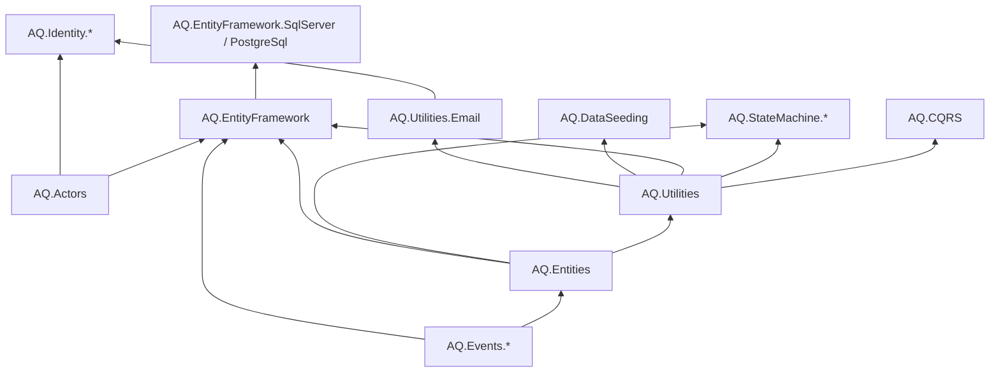

# AQ-Libraries — what the libraries guarantee

This is the one place that says what every shared library does, what it promises its callers and what it refuses to do. The code is the source of truth; this file describes it, and `scripts/docs-sync.ps1` fails the build when the two drift apart.

Read it before changing a library or relying on one. Technical conventions for working in a layer live in [dotnet/CLAUDE.md](../dotnet/CLAUDE.md) and [react/CLAUDE.md](../react/CLAUDE.md). Step-by-step usage guides (filter syntax, seeder examples, logo overrides) stay next to the code they describe and are linked from the sections below.

Every rule has an id (three capital letters, a dash and a number). The line of code that enforces it carries a `// RULE ACT-2` comment, so a rule can be traced from this file to its code and back. A rule here without a tag in code, or a tag in code without a rule here, fails the check.

## Package graph

<!-- BEGIN:surface -->
_Generated by `scripts/docs-sync.ps1 -Write` from the project files. Do not edit._

**.NET libraries** (`dotnet/src`)

| Library | Folder | AQ libraries it references | External packages |
|---|---|---|---|
| AQ.Actors | dotnet/src/Actors | none | Microsoft.Extensions.Hosting.Abstractions |
| AQ.CQRS | dotnet/src/CQRS | AQ.Utilities | Microsoft.Extensions.Logging |
| AQ.DataSeeding | dotnet/src/DataSeeding | AQ.Utilities | Microsoft.EntityFrameworkCore, Microsoft.EntityFrameworkCore.Relational, Microsoft.Extensions.DependencyInjection, Microsoft.Extensions.Logging |
| AQ.Entities | dotnet/src/Entities | AQ.Events.Domain | none |
| AQ.EntityFramework | dotnet/src/EntityFramework | AQ.Actors, AQ.Entities, AQ.Events.Outbox, AQ.Utilities | Microsoft.EntityFrameworkCore.Relational, Microsoft.Extensions.DependencyInjection |
| AQ.EntityFramework.PostgreSql | dotnet/src/EntityFramework/PostgreSql | AQ.EntityFramework, AQ.Utilities | Npgsql.EntityFrameworkCore.PostgreSQL |
| AQ.EntityFramework.SqlServer | dotnet/src/EntityFramework/SqlServer | AQ.EntityFramework, AQ.Utilities | Microsoft.EntityFrameworkCore.SqlServer |
| AQ.Events.Dispatchers | dotnet/src/Events/Dispatchers | AQ.Events.Domain | Microsoft.Extensions.Logging |
| AQ.Events.Domain | dotnet/src/Events/Domain | none | none |
| AQ.Events.Integration | dotnet/src/Events/Integration | none | none |
| AQ.Events.Outbox | dotnet/src/Events/Outbox | AQ.Actors, AQ.Entities, AQ.Events.Domain, AQ.Events.Integration | none |
| AQ.Generators | dotnet/src/Generators | none | Microsoft.CodeAnalysis.Analyzers, Microsoft.CodeAnalysis.CSharp |
| AQ.Identity.Core | dotnet/src/Identity/Core | AQ.Actors, AQ.Utilities.Email | Microsoft.AspNetCore.Identity.EntityFrameworkCore |
| AQ.Identity.OpenIddict | dotnet/src/Identity/OpenIddict | AQ.Identity.Core, AQ.Utilities | FastEndpoints, Microsoft.AspNetCore.Authentication.Google, OpenIddict.Abstractions, OpenIddict.AspNetCore, OpenIddict.EntityFrameworkCore, OpenIddict.Quartz, OpenIddict.Server, OpenIddict.Server.AspNetCore, OpenIddict.Validation, Serilog.AspNetCore, Serilog.Enrichers.Environment, Serilog.Sinks.Console |
| AQ.Identity.UI | dotnet/src/Identity/UI | AQ.Identity.Core, AQ.Identity.OpenIddict | OpenIddict.Server.AspNetCore, QRCoder |
| AQ.StateMachine.Entities | dotnet/src/StateMachine/Entities | AQ.Entities, AQ.Utilities | none |
| AQ.StateMachine.Services | dotnet/src/StateMachine/Services | AQ.StateMachine.Entities, AQ.Utilities | Microsoft.Extensions.Logging |
| AQ.Utilities | dotnet/src/Utilities | AQ.Entities | Microsoft.Extensions.DependencyInjection |
| AQ.Utilities.Email | dotnet/src/Utilities/Email | AQ.Utilities | MailKit, Microsoft.Extensions.Hosting.Abstractions, Microsoft.Extensions.Localization, Microsoft.Extensions.Options, Microsoft.Extensions.Options.ConfigurationExtensions |
| AQ.ValueObjects | dotnet/src/ValueObjects | none | HtmlSanitizer, Markdig, ReverseMarkdown |

**React package** (`@AQ/react-components`, `react/src`)

- Component folders (`src/mantine`): address, attachments, autocomplete, data-grid, datetime, editor, html-display, locale, master-detail, money, split-button, theme
- Utilities (`src/utils`): DateTimeOffsetUtils, FilterExpressionBuilder, SortExpressionBuilder
- Runtime dependencies: none
- Peer dependencies: @mantine/core >=8, @mantine/dates >=8, @mantine/hooks >=8, @mantine/modals >=8, @mantine/notifications >=8, @tabler/icons-react >=3, @tanstack/react-query >=5, @tiptap/core >=3.7, @tiptap/extension-audio >=3.7, @tiptap/extension-highlight >=3.7, @tiptap/extension-image >=3.7, @tiptap/extension-link >=3.7, @tiptap/extension-list >=3.7, @tiptap/extension-mathematics >=3.7, @tiptap/extension-subscript >=3.7, @tiptap/extension-superscript >=3.7, @tiptap/extension-table >=3.7, @tiptap/extension-text-align >=3.7, @tiptap/extension-underline >=3.7, @tiptap/extension-youtube >=3.7, @tiptap/markdown >=3.7, @tiptap/pm >=3.7, @tiptap/react >=3.7, @tiptap/starter-kit >=3.7, dayjs >=1, katex >=0.16, react >=19, react-dom >=19
<!-- END:surface -->

How the layers stack, from the bottom up:

Apps consume the libraries by project reference. A library never knows an app: the identity UI carries no app branding, the search core knows no database, the save pipeline knows no user table.

## Actors <!-- projects: AQ.Actors -->

"Who is doing this now". It has no dependency on any other AQ library, so every layer can use it.

- **ACT-1** Every write is attributed to an actor: a stable principal id, a kind (person, registered service client, or platform work), optionally the principal it acts for, the OAuth client it came from and a correlation id.
- **ACT-2** The current actor flows with the async call chain. Reading the current actor when none is active throws a missing-actor error; the try-get form returns false instead.
- **ACT-3** Beginning an actor scope makes that actor current until the scope is disposed, then restores the previous one. Scopes nest; disposing out of order only marks the scope, and it is skipped once reached.
- **ACT-4** The scope factory opens a fresh dependency-injection scope and an actor scope together, so scoped services such as the DbContext always run under an actor, and both end together.
- **ACT-5** A hosted service that touches the database derives from the actor background service, declares the actor it writes as, and reaches scoped services only through its run-scoped helper.
- **ACT-6** Registration adds the context and the factory without replacing registrations the app made itself.

## Entities, events and the outbox <!-- projects: AQ.Entities, AQ.Events.Domain, AQ.Events.Integration, AQ.Events.Dispatchers, AQ.Events.Outbox -->

Base types for aggregates, plus the event plumbing. Where events are saved and who stamps them is the save pipeline's job (see EntityFramework).

- **ENT-1** A new entity gets a time-ordered GUID id, a creation time of now and revision 0.
- **ENT-2** A save stamps the update time and raises the revision by one.
- **ENT-3** Created-by is set once: it never overwrites an existing creator, and the updater starts out equal to the creator.
- **ENT-4** Marking an auditable entity updated records the updater, the update time and the next revision.
- **ENT-5** Domain events raised by an entity stay on the entity until the save pipeline takes them; adding a null event is refused.
- **ENT-6** Removing an entity whose removal check says no throws, naming the entity type and id.
- **ENT-7** Changing a hierarchical entity's parent first runs the caller-supplied closure update, then assigns the parent. A root has no parent; a leaf has no children.
- **ENT-8** Marking an entity as audited opts it, and its subtypes, into the audit log; marking a property as audit-ignored keeps its value out of the recorded changes.
- **EVT-1** A domain event records when it occurred. Its actor, on-behalf-of and correlation id are filled in by the save pipeline, never by callers.
- **EVT-2** The dispatcher hands an event to every handler registered for its type, one after another. A failing handler is logged with the event data and the failure is rethrown, so later handlers do not run.
- **EVT-3** A typed handler is invoked only for events of its own type; the untyped bridge ignores anything else.
- **EVT-4** Registering handlers from an assembly adds every concrete handler as scoped, once per event type it handles.
- **EVT-5** An integration event gets a new id and the current time unless both are supplied.
- **EVT-6** An outbox event is created with the actor that caused it, unprocessed and with zero attempts, and can rebuild that actor later.
- **EVT-7** Marking an outbox event processed stamps the time and clears its error and next attempt. Recording a failure counts an attempt, keeps the error and schedules the retry.
- **EVT-8** An outbox event is ready when it is unprocessed and its next attempt is empty or due. It has run out of retries when its attempts reach the limit.

## Entity Framework integration <!-- projects: AQ.EntityFramework -->

The save pipeline, the audit log, snapshot storage and pruning, version groups, tags and the hierarchy service. Options switch each step on; the steps always run in the order below.

- **EFC-1** The save pipeline runs, when enabled: tag link correction, owned-change touch, actor check, lifecycle hooks, version groups, generated references, verification reset, audit stamping, snapshots, audit log, outbox. A save with nothing for a step to do skips it.
- **EFC-2** When audit, outbox or audit log is on and a save changes an auditable entity, raises a domain event or changes an audited entity, an actor must be active. Without one the save throws a missing-actor error instead of storing empty attribution.
- **EFC-3** Stamping: an added auditable entity gets its creator, updater and creation time; a modified one gets its updater, update time and next revision. An entity that is timestamped but not auditable gets times and revision only and needs no actor.
- **EFC-4** When only an owned part of an entity changed (a value object, verification state, review state), the owner is still treated as modified and its revision rises, so stamping, snapshots and the audit log do not skip the save. A review reminder bookmark alone does not count as an edit.
- **EFC-5** Lifecycle hooks run per tracked entity: on add, on update and on remove (which can veto), and the active flag is re-evaluated for added and modified entities.
- **EFC-6** An added entity gets its generated reference only when that property is empty; an existing value is kept.
- **EFC-7** When a property marked verifiable changes on a modified entity, its verification history resets. A review recorded in the same save survives the reset and counts as a fresh verification by the reviewer.
- **EFC-8** Each added or modified entity that is snapshottable gets a snapshot row holding its id, revision and the data of its snapshot members.
- **EFC-9** Every insert, update and delete of an audited entity writes one audit event in the same save, with the actor and the changed values. An update that changed nothing recordable writes nothing.
- **EFC-10** The recorded changes list new values for inserts, old values for deletes, and old and new for updates. Revision, update time, updater, keys, shadow properties and audit-ignored properties are left out; owned parts are folded into their owner under dotted paths.
- **EFC-11** The audit log is append-only: changing or deleting an audit event through the pipeline throws.
- **EFC-12** Recording history never fails the save it describes: a value that cannot be written as JSON is recorded as text.
- **EFC-13** Each domain event on a saved entity is stamped with the actor, written as an outbox row with its serialized payload, and then cleared from the entity.
- **EFC-14** The audited bulk update adds updater, update time and revision plus one to the caller's changes. Bulk statements bypass the pipeline, so they write no audit event.
- **EFC-18** Moving a node in a hierarchy rebuilds the closure rows of its whole subtree; making a node a child of its own descendant is refused with an error.
- **EFC-19** The closure can be recomputed for one subtree or for everything, from the parent links, which are authoritative.
- **EFC-20** The verification and review states map to fixed column names, and a review state is always materialized, never null, even for a never-reviewed row.
- **EFC-21** All snapshots live in one shared table keyed by entity type, with a unique index on entity and version.
- **EFC-22** Each snapshot type has a required link to its entity, and deleting the entity deletes its snapshots. History that must outlive an entity is the entity's own business (soft delete or status).
- **EFC-23** Pruning keeps at most the configured number of newest snapshots per entity and removes the older ones. Snapshots are ranked by how many newer ones the entity has, never by version arithmetic, so gaps in version numbers do not matter.
- **EFC-24** Pruning never removes an entity's newest snapshot. A snapshot is removed only when it is beyond every limit that is set (number kept, and age in days); with no limit set nothing is removed. A limit on the entity's snapshot attribute can be replaced per entity type by configuration, where zero clears it.
- **EFC-25** The model builder gives every version-grouped entity an index on its group and a unique index on group and version, so one group never holds the same version twice.
- **EFC-26** An added version-grouped entity that has no group gets a new group of its own when the save runs, so every row always belongs to a group. One added with a group keeps it.
- **EFC-27** Every record has each tag at most once: tag links share one table keyed by entity type, with a unique index on record and tag.
- **EFC-28** A tag that is still on a record cannot be deleted; the app removes it from the records first.
- **EFC-29** Each tag link type has a required link to its record, and deleting the record deletes its links but never the tags.
- **EFC-30** A tag link added through a tracked record's collection is inserted: links are never edited, so one the change tracker finds as modified is treated as new unless its row already exists, in which case it is left as it is.

### Search providers <!-- projects: AQ.EntityFramework.SqlServer, AQ.EntityFramework.PostgreSql -->

Provider packages translate the search operators that plain LINQ cannot express. Reference only the one that matches your database and register it once at startup. Usage guide: [Search README](../dotnet/src/Utilities/Search/README.md).

- **SRC-3** A dialect handles string properties only; any other property type never matches. Every predicate is guarded so a null string does not match and does not throw.
- **SRC-4** SQL Server: fuzzy matching compares `DIFFERENCE` against 3, or 4 when the minimum similarity is 0.8 or more; phonetic compares `SOUNDEX`; full text uses `FREETEXT` and needs a full-text index on the column.
- **SRC-5** PostgreSQL: fuzzy matching uses trigram similarity at or above the minimum similarity; phonetic compares `soundex`, with the term's code computed in the app; full text matches an English `tsvector` against a plain query.

## Source generators <!-- projects: AQ.Generators -->

A Roslyn incremental generator, referenced as an analyzer, that writes the snapshot classes and their registrations, and the members of version-grouped and taggable classes.

- **GEN-1** A class marked snapshottable gets a generated snapshot class, named after the class or the name given, and a registration so the save pipeline can create snapshots of it. The registration carries the link back to the entity and the retention limits set on the attribute (number kept, age in days).
- **GEN-2** A class marked as a version group gets generated group and version members and the version-group interface. It must be a partial, non-generic, top-level entity class that does not already declare the members the generator adds, otherwise the build fails with `AQGEN002`.
- **GEN-3** A class marked snapshottable with no decorated members in its hierarchy gets warning `AQGEN001`; an attribute option naming a member that does not exist fails the build with `AQGEN003`.
- **GEN-4** Registrations run from a module initializer and are idempotent, so the data writers exist before the first save without any app code calling them.
- **GEN-5** Output is deterministic: members and classes are emitted in a stable order, so a rebuild with no changes produces identical files.
- **GEN-6** A negative `KeepLast` or `MaxAgeDays` on a snapshottable class fails the build with `AQGEN004`; 0 means no limit.
- **GEN-7** A snapshottable class can set `Name`, used for its snapshot link, discriminator and retention configuration key instead of the class name. Two snapshottable classes ending up with the same name fail the build with `AQGEN005`.
- **GEN-8** A class marked taggable gets a generated tags collection, a link type named after the class (or the name given), a registration and query helpers. It must be a partial, non-generic, top-level entity class and name a tag type that implements the tag interface, not already declare the members the generator adds, and use a name that is a valid identifier and does not clash with an existing type, otherwise the build fails with `AQGEN002`. The entity interface must be the non-generic one with a Guid key.
- **GEN-9** Two taggable classes ending up with the same name fail the build with `AQGEN006`. Adding a tag id the class already has is a no-op.

## Utilities <!-- projects: AQ.Utilities -->

One package holding the cross-cutting helpers. Each part below stands alone.

### Results

Usage: [Results README](../dotnet/src/Utilities/Results/README.md).

- **RES-1** A successful result cannot carry an error and a failed result must carry one; creating either wrong throws.
- **RES-2** Reading the value of a failed result throws.
- **RES-3** An error maps to an HTTP status: not found 404, validation 400, conflict 409, unauthorized 401, forbidden 403, business rule 422, anything else 400.

### Filtering

Usage: [Filter README](../dotnet/src/Utilities/Filter/README.md).

- **FLT-1** A filter condition is `Property.Path,operator,value`. Operator names and symbols are case-insensitive; quoted values may contain commas.
- **FLT-2** An unknown operator, a missing value, or a between filter without two values throws an argument error when the expression is parsed. Null checks need no value; in and not-in take every remaining value.
- **FLT-3** A complex expression combines conditions with `&&` and `||` and parentheses.
- **FLT-4** A condition that cannot be built, because the property does not exist or the value cannot be converted, is dropped silently. If every condition is dropped the query is returned unfiltered, so callers that need strictness validate property names first.
- **FLT-5** An empty or missing filter string returns the query unchanged.
- **FLT-6** Contains, starts-with and ends-with comparisons ignore case unless the condition asks for case-sensitive matching. Equality follows the database's own collation.

### Sorting

Usage: [Sort README](../dotnet/src/Utilities/Sort/README.md).

- **SRT-1** A sort condition is `Property.Path` or `Property.Path,direction`; a leading `-` means descending and cannot be combined with an explicit direction. Several conditions are joined with `;`.
- **SRT-2** An unknown direction or an empty condition throws an argument error when the expression is parsed.
- **SRT-3** Conditions apply in priority order, the first as the primary sort and the rest as tie-breakers. A condition naming an unknown property is skipped.
- **SRT-4** An empty or missing sort returns the query unchanged.

### Searching

Usage: [Search README](../dotnet/src/Utilities/Search/README.md). The provider-specific operators are described under Search providers above.

- **SRC-1** Exact, contains, starts-with and ends-with search are plain LINQ any EF Core provider translates. A null string never matches and never throws.
- **SRC-2** Fuzzy, phonetic and full-text operators throw a not-supported error naming the operator unless a provider dialect is registered. There is no silent fallback to contains.
- **SRC-6** Searchable fields are the properties marked searchable. A type with none, in itself and its derived types, falls back to every readable, writable, simple-typed property, strings included; collections and not-mapped properties are excluded, and a private setter is fine.
- **SRC-7** A search condition naming an unknown property is skipped; the other conditions still apply.
- **SRC-8** A scored search loads the matching entities into memory, drops results below the minimum score (0.1 by default), orders by score and caps the count at the maximum results when one is set.
- **SRC-9** Search does not paginate; callers page the scored results themselves.
- **SRC-10** Searchable members declared on a derived type are searched only for records of that type; a type with none anywhere in its hierarchy falls back as in SRC-6.
- **SRC-11** An entity marked with the parent-search attribute is also searched by the listed members of its direct parent; ancestors further up are not searched.

### Merging

- **MRG-1** Merging attaches duplicates to a primary by setting their primary id. The primary must itself be unmerged, and an entity cannot be merged into itself or into another entity while it is already merged; duplicates in the list are counted once.
- **MRG-2** Unmerging an entity that is not merged throws.
- **MRG-3** The merge query helpers return the primary plus its merged records, resolve an entity to its effective primary, and group records by primary.

### Verification and review

- **VER-1** Verification state keeps a count and one entry per verification (who and when). Resetting clears both and stamps when the reset happened.
- **VER-2** Verification can be asked "has this user verified" from the entries.
- **RVW-1** Marking an entity reviewed stamps who and when, links the activity, sets the next due date (keeping a still-future one when none is given) and clears the notified flag.
- **RVW-2** Reviewing an entity that is also verifiable adds the reviewer to its verification history unless they are already in it, and reports whether it did.
- **RVW-3** A review is due when its due date has passed and nobody has been notified since that date. It is current when it happened at or after the last verification reset.

### Snapshots, version groups and entity data

- **VSN-1** Snapshot data is JSON built from the members marked for it, in camelCase, writer by writer from the base type down to the concrete type.
- **VSN-2** The snapshot registry looks a runtime type up through its base types, so a derived entity finds the registration of its base.
- **VSN-4** An entity joins another record's version group under a version label. It cannot join through itself or a group it is already in, and the caller checks that the label is free in the target group.
- **VSN-5** Leaving a version group moves the entity into a new group of its own and keeps its label. The records it left stay together.
- **VSN-6** Changing a version label keeps the entity in its group. The caller checks that the new label is free in that group.
- **VSN-7** A version label is trimmed, cannot be blank and is at most 100 characters.
- **VSN-8** The version-taken query finds the records of a group that carry a label, and can leave out the record being changed.
- **VSN-9** A version-grouped class that is snapshottable, directly or through a base type, also writes its group and version into its snapshots.

### Tagging

- **TAG-1** Setting the tags of a record makes it carry exactly the given tags: the ones it lacks are added, the ones the set lacks are removed, and empty ids are ignored.
- **TAG-2** Adding tags skips the ones the record already carries and the duplicates in the request, and empty ids.

### Generated references

- **REF-1** A property marked with a generated reference is filled only when blank. The generator must implement the reference generator contract, or the attribute throws.
- **REF-2** The short-code generator draws from a Crockford base32 alphabet (no I, L, O, U) with a cryptographic random source and needs a length above zero.
- **REF-3** Counter-based references need database access this library does not own; the app subclasses the sequential generator and supplies the next value.

### Attachment limits

- **ATT-1** An entity type can declare a count limit, a file size limit and the allowed content kinds; a limit of 0 or no declaration means "use the app's global default".

## Email <!-- projects: AQ.Utilities.Email -->

- **EML-1** Email bodies are localized from resource files; the culture is the one passed in or, when omitted, the current UI culture, and it is restored when the call ends.
- **EML-2** Every value inserted into an email's HTML is HTML-encoded, and the document's `lang` reflects the effective culture.
- **EML-3** Mail goes over SMTP whenever a host is configured. The console sender is used only in Development with no host. Options are read live, so a database-backed configuration change applies without a restart.

## CQRS <!-- projects: AQ.CQRS -->

- **CQR-1** A handler validates first; a failed validation is returned as a failed result and the handler body does not run.
- **CQR-2** Business failures are returned as failed results. Any exception inside a handler is a technical error and is rethrown wrapped in an invalid-operation error naming the command or query.
- **CQR-3** Dispatching a command or query with no registered handler returns a not-found failed result; it does not throw.
- **CQR-4** Exceptions from a handler pass through the dispatcher unchanged after being logged.
- **CQR-5** Registration adds the two dispatchers and every command and query handler found in the given assemblies, all as scoped.
- **CQR-6** A list query defaults to page 1 with 50 rows per page and carries the filter, search and sort expressions.

## State machines <!-- projects: AQ.StateMachine.Entities, AQ.StateMachine.Services -->

Usage and worked examples: [State machine README](../dotnet/src/StateMachine/Entities/README.md).

- **SMC-1** A definition is Draft, Published, Deprecated or Archived. Publishing runs validation first and throws when it finds errors.
- **SMC-2** A definition is valid when it has at least one state, an entry transition, no state that nothing leads to, and no trigger that is unused (a records-only trigger needs no transition).
- **SMC-3** The mapping from the previous version's states can only be set while the definition is a draft.
- **SMC-4** A records-only trigger never changes state. Any other trigger needs a transition from the current state, otherwise firing it throws.
- **SMC-5** Migrating an instance to a new definition moves it by state id through the stored mapping. A state with no mapping, or a mapped state that is missing, throws. The time spent in the current state is kept, and the migration is appended to the instance's history.
- **SMC-6** Requirement evaluation runs the handlers written for each requirement's exact type first. They are alternatives: the first one that succeeds fulfils the requirement, and a handler that throws only records a failure reason.
- **SMC-7** Then every registered general handler sees all requirement results and may change them. A general handler that throws leaves the unfulfilled requirements with that reason; evaluation carries on.
- **SMC-8** All requirements are met when each is fulfilled or optional.
- **SMC-9** Requirements are matched to handlers and context by the requirement's type name, never by a string constant.
- **SMC-10** Raising the transitioned event adds a domain event carrying the instance, the definition id and version and the target state, so it is saved with the state change.

## Data seeding <!-- projects: AQ.DataSeeding -->

Usage: [Data seeding README](../dotnet/src/DataSeeding/README.md).

- **SED-1** Seeders of one type run dependencies first; seeders with no ordering between them run by priority, lowest first.
- **SED-2** A dependency that is not registered as the same seeder type throws.
- **SED-3** A seeder marked skip is not run, and neither is any seeder that depends on it.
- **SED-4** Seeding by name matches class names ignoring case and resolves each named seeder's dependencies first.

## Value objects <!-- projects: AQ.ValueObjects -->

- **VOB-1** Value objects are equal when their atomic values are equal, and can be cloned.
- **VOB-2** An email is trimmed and lower-cased, at most 254 characters, and must match the email pattern; otherwise creation throws.
- **VOB-3** A phone number has spaces, dashes and brackets removed and must match the phone pattern.
- **VOB-4** A full name is 2 to 100 characters.
- **VOB-5** A country is an ISO 3166-1 alpha-2 code; an address needs a valid country and limits street to 100, city and state to 50 and postal code to 20 characters, with blank parts stored as missing.
- **VOB-6** Money has a three-letter ISO 4217 currency, stored upper-case. Adding or subtracting different currencies throws; the try-create form returns nothing for an invalid currency.
- **VOB-7** A date range or date-time range cannot end before it starts. Asking for a duration of a range that is not closed throws.
- **VOB-8** A range-validated value must lie inside its numerical range; the try-create form reports failure instead of throwing.
- **VOB-9** HTML content is sanitized when it is created, whether it came as HTML or was converted from markdown. Markdown content is sanitized when rendered.
- **VOB-10** A choice field must list its allowed values, and a collected value must be non-empty when required, of the declared data type, and one of the allowed values for choice fields.

## Identity <!-- projects: AQ.Identity.Core, AQ.Identity.OpenIddict, AQ.Identity.UI -->

A config-driven OpenIddict identity provider split into Core (options, entities, abstractions), OpenIddict (server wiring, key management, admin API) and UI (Razor pages). An app registers it with `AddAqIdentity<TContext>` and `UseAqIdentity`, supplying its own DbContext and its OAuth clients. There is one identity deployment per consuming app and no tenant concept. Usage and integration notes: [Identity README](../dotnet/src/Identity/README.md) and [Identity UI README](../dotnet/src/Identity/UI/README.md).

- **IDC-1** A service client's extra claims may not set the claims that say who the caller is (subject, principal type, client id, internal user id); seeding and the admin pages and endpoints refuse them.
- **IDC-2** An audit entry records the actor separately from the person acted on, including the actor's kind (anonymous, human, service or system). Only an anonymous entry has no actor id.
- **OID-1** Every client-credentials client has a stable principal id stored on the application, created with the client, kept across updates and secret resets, and assigned on first use to older clients without one. Concurrent first requests agree on one id.
- **OID-2** A service token's subject is the client's principal id and it carries the principal type `service` and the client id; a person's token carries the principal type `human`.
- **OID-3** Every sign-in gets a browser session id that is carried into tokens and stored on the app session. Signing out ends every app session with the browser's session id, plus the one named by the logout hint, and leaves the same user's other devices alone. A hint for a different user is ignored.
- **OID-4** Ending one app session by id only works for the session's owner; ending all sessions of a user also sweeps tokens not tied to a session.
- **OID-5** Reusing a refresh token is detected, audited as such and ends the session.
- **OID-6** A client that registers a back-channel logout address is sent a signed logout token whenever one of its sessions ends. The call has a 5 second timeout and a failed delivery is logged, never raised.
- **OID-7** An access token's audience is the resources of its scopes.
- **OID-8** The management API takes bearer tokens only and answers 401, never a login redirect, when the token is missing. It requires the management claim; the Razor admin console uses the same policy with cookies.
- **OID-9** Every change made through the management API or the admin console is written to the audit log with the acting admin or service.
- **OID-10** The last administrator cannot lose the management claim, directly or by being deactivated, because that would reopen the unauthenticated first-run setup.
- **OID-11** Signing keys rotate on a schedule by a background worker, which logs as the key-rotation system actor.
- **IDU-1** Account and sign-in pages are localized to English, zh-CN, zh-TW and zh-HK. The culture comes from the OIDC `ui_locales` parameter, then the culture cookie, then the browser's language, then English. The admin console stays in English.
- **IDU-2** The culture switch accepts only a supported culture before setting the cookie.
- **IDU-3** Every response carries a content security policy locked to the app's own origin. Because it is shared by all consumers, an app brands the pages through the logo setting or by overriding the layouts in its own project, hosting its own fonts and styles; the shared pages carry no app-specific branding.

## React components <!-- projects: @AQ/react-components -->

A source-only TypeScript package of Mantine-based components, consumed through a path alias with no build step. See [react/CLAUDE.md](../react/CLAUDE.md) for conventions.

- **RCT-1** Runtime libraries (React, Mantine, TanStack Query, dayjs, icons, editor) are peer dependencies only; the package declares no runtime dependency, so a consuming app never gets a second copy of React or Mantine.
- **RCT-2** Components read their user-visible text through the locale hook. With no locale provider mounted the hook returns the built-in English messages, so an app that does not opt in sees English.
- **RCT-3** Messages passed to the locale provider are merged over the English defaults, so a partial translation falls back to English for the rest. A label passed as a prop always wins over the locale message for that string.
- **RCT-4** The filter and sort expression builders produce the strings the Filter and Sort utilities parse: `property,operator,value` joined by `&&` or `||`, and `property,direction` joined by `;`.
